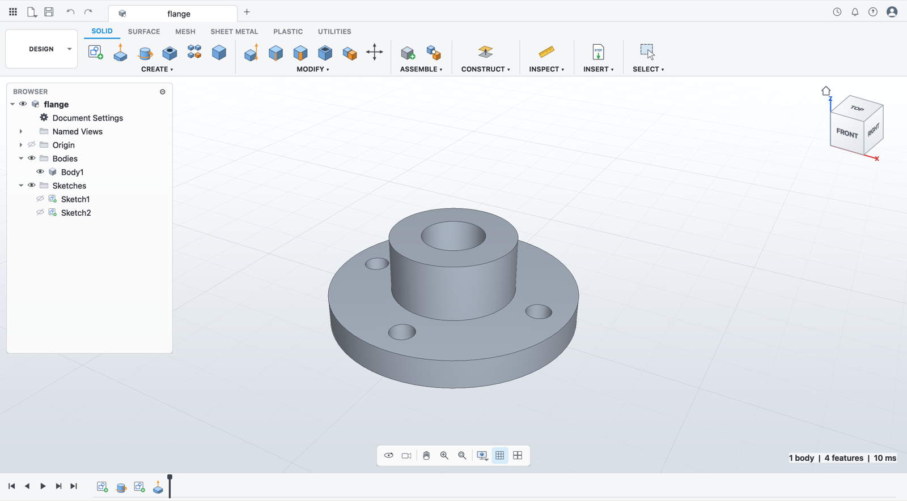

<p align="center">
  <picture>
    <source media="(prefers-color-scheme: dark)" srcset="docs/brand/wordmark-dark.svg">
    
  </picture>
</p>

<p align="center"><b>Open-source parametric CAD.</b> Sketch, constrain, extrude, fillet; change a parameter and the whole design regenerates.</p>



FuseCAD is a history-based solid modeller written in C++20 on
[OpenCASCADE](https://occt3d.com) and Qt 6. Every dimension can be an
expression over named parameters, and every feature is a step on an editable
timeline.

**Status:** pre-release. The parametric core, kernel and desktop shell work;
interactive sketching and feature editing in the viewport are next. See the
[roadmap](docs/ROADMAP.md).

## Features

- **Parameters:** named expressions with units (`mm`, `in`, `deg`, ...) and functions
- **Sketcher:** lines, arcs, circles; 17 constraints; degree-of-freedom analysis
- **Features:** extrude, revolve, fillet, chamfer, boolean join/cut/intersect, STEP import
- **Timeline:** rollback, suppress, rename, undo/redo
- **Files:** `.fcad` (plain JSON); STEP and STL export
- **CLI:** `fusecad-cli` creates, inspects, re-parameterises and exports designs headlessly

## Build

Requires CMake ≥ 3.25, Ninja, a C++20 compiler, OpenCASCADE ≥ 7.8, Qt ≥ 6.5,
nlohmann-json and doctest.

macOS:

```sh
brew install cmake ninja opencascade qt nlohmann-json doctest
cmake --preset dev && cmake --build --preset dev
open build/dev/apps/fusecad/fusecad.app
```

Ubuntu 26.04:

```sh
sudo apt install cmake ninja-build g++ nlohmann-json3-dev doctest-dev \
  libocct-data-exchange-dev qt6-base-dev libgl-dev
cmake --preset dev && cmake --build --preset dev && ctest --preset dev
```

From the command line:

```sh
cli=build/dev/apps/fusecad-cli/fusecad-cli
$cli new plate.fcad --sample plate
$cli export plate.fcad plate.step -p width=120mm
```

## Learn more

[Architecture](docs/ARCHITECTURE.md) · [Roadmap](docs/ROADMAP.md) · [Contributing](CONTRIBUTING.md)

## License

[GPL-3.0-or-later](LICENSE). Uses OpenCASCADE (LGPL-2.1 with exception) and Qt (LGPL-3.0).
