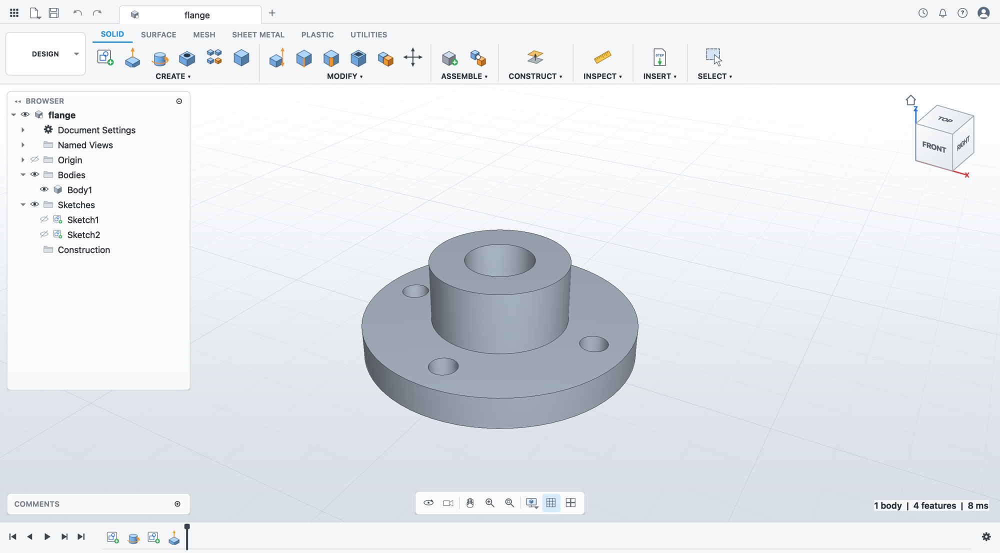

# OpenCircuit

**Free and open-source parametric CAD, written in modern C++.**

Sketch, constrain, extrude, revolve, fillet: every dimension driven by named
parameters, every feature on an editable history timeline. Change `width` from
80 mm to 120 mm and the whole design regenerates in milliseconds.



> **Status: early development (v0.1).** The parametric core, geometry kernel and
> desktop shell are in place. Interactive sketching and feature editing in the
> viewport are next; see the [roadmap](docs/ROADMAP.md). Commands not built yet
> are visible in the UI and say so when you click them.

## What works today

| Area | Capabilities |
|---|---|
| **Parameters** | Named user parameters with expressions, units (`mm`, `cm`, `in`, `deg`, ...) and functions; references between parameters, cycle detection |
| **Sketcher** | Points, lines, circles, arcs; 17 constraints (coincident, parallel, tangent, symmetric, distance, angle, ...); degree-of-freedom and fully-constrained analysis; dimensions bound to parameters |
| **Profiles** | Automatic detection of closed regions, including holes and nested islands |
| **Features** | Extrude (new body, join, cut, intersect, symmetric), revolve, fillet, chamfer, STEP import, parametric box and cylinder |
| **Timeline** | Ordered history with rollback marker, suppress, rename, delete, undo/redo |
| **Files** | Native `.ocd` (JSON, diff-friendly); STEP and STL export; STEP import |
| **Desktop app** | Command ribbon, design browser with visibility toggles, ViewCube, navigation bar, radial marking menu (right-click), history timeline, display styles |
| **CLI** | `oc-cli` to create, inspect, re-parameterise and export designs headlessly |

## Build

Requirements: CMake ≥ 3.24, Ninja, a C++20 compiler, [OpenCASCADE](https://dev.opencascade.org/) ≥ 7.6,
Qt ≥ 6.5 (desktop app only), nlohmann-json, doctest.

**macOS**

```sh
brew install cmake ninja opencascade qt nlohmann-json doctest
cmake --preset dev
cmake --build --preset dev
open build/dev/apps/opencircuit/opencircuit.app
```

**Ubuntu 24.04** (core libraries, kernel and CLI)

```sh
sudo apt install cmake ninja-build g++ nlohmann-json3-dev doctest-dev \
  libocct-foundation-dev libocct-modeling-algorithms-dev libocct-modeling-data-dev libocct-data-exchange-dev
cmake --preset ci && cmake --build --preset ci && ctest --preset ci
```

Helper scripts: `scripts/run.sh` builds and launches the app; `scripts/watch.sh`
rebuilds and relaunches it whenever a source file changes.

| Preset | Purpose |
|---|---|
| `dev` | Debug build of everything, warnings as errors |
| `release` | Optimised build |
| `asan` | `dev` plus AddressSanitizer and UndefinedBehaviorSanitizer |
| `core-only` | Core libraries without OpenCASCADE or Qt |
| `ci` | Headless (no Qt) build used by continuous integration |

## Try it from the command line

```sh
B=build/dev/apps/oc-cli/oc-cli
$B new plate.ocd --sample plate          # a filleted plate with a hole
$B info plate.ocd                        # parameters, timeline, bodies, volumes
$B export plate.ocd plate.step -p width=120mm -p hole_d="1 in"
```

## Architecture in one picture

```
 apps/opencircuit (Qt 6 UI)      apps/oc-cli
            \                      /
             oc::model   — features, timeline, documents, .ocd files
                 |
             oc::kernel  — abstract geometry-kernel interface
              /      \
     oc::sketch     oc::occt — OpenCASCADE implementation
         |
      oc::core       — math, units, expressions, parameters
```

Each layer depends only on the layers below it; `core` and `sketch` have no
third-party dependencies at all. Details and design decisions are in
[docs/ARCHITECTURE.md](docs/ARCHITECTURE.md).

## Contributing

Contributions are very welcome; start with [CONTRIBUTING.md](CONTRIBUTING.md).

## License

OpenCircuit is licensed under the [GNU General Public License v3.0 or later](LICENSE).
It uses [Open CASCADE Technology](https://dev.opencascade.org/) (LGPL-2.1 with exception)
and [Qt](https://www.qt.io/) (LGPL-3.0).
